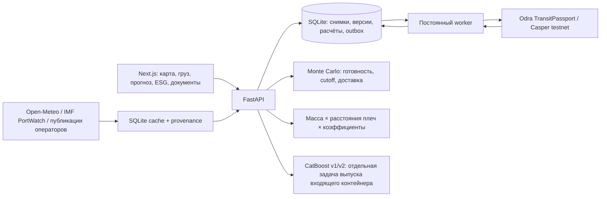

# Архитектура Caspian Transit

Актуально на 13.11.2026. Реализованный прототип кейса Smart Caspian Transit.

Next.js показывает согласованный снимок отправки из FastAPI. SQLite хранит отправки,
версии документов, расчёты и постоянную очередь операций. Отдельный worker подписывает
операции трёх preview-ролей и сверяет результат исполнения с Casper testnet.

## Данные и расчёт

- Каталог содержит 11 портов пяти стран. При отсутствии проверенных координат точка
  не придумывается. Open-Meteo даёт прогноз, IMF PortWatch — исторические оценки
  судозаходов по AIS. Опубликованные направления и диспозиции не подтверждают бронь,
  текущий рейс или свободные места.
- `POST /api/v1/shipments/{id}/recalculate` собирает погоду в портах отправления
  и назначения и активность портов, строит сценарии и сохраняет общий результат:
  маршруты, готовность P10/P50/P90, риск пропустить cutoff, ETA и ESG.
- Погода: максимум ветра на доступных часах следующих 48 часов. Условная задержка:
  `min(48, max(0, (wind - wind_limit) / 5) * 2)` часов. Порог и зависимость —
  настраиваемая политика сценария, не правило безопасности судна и не обученная модель.
- Активность: если последняя запись не старше трёх дней и кэш не устарел,
  терминальное время умножается на `clamp(latest_portcalls / median_portcalls, 0.5, 2)`.
  Это явно обозначенная эвристика, а не измеренная очередь. Иначе используется
  заданное пользователем терминальное время; отсутствие активности не заменяется нулём.
- Доставка до порта считается от `current_location`: приближённое расстояние по сфере
  ×1.4, условная скорость 40 км/ч для ж/д или 60 км/ч для авто и отдельная
  задержка соответствующего вида транспорта. Морское расстояние ×1.1,
  условная скорость 20 км/ч. Геометрия отображения отделена от этих оценок;
  морские линии используют проверенную маску воды, не являются навигационными путями.
- Демо-расписание: первый cutoff через указанное число часов; смещения для Астрахани,
  Махачкалы, Актау и Туркменбаши — 0/12/36/60 часов. Отправление через два часа после
  cutoff, последующие условные рейсы через указанный интервал. Это не расписание оператора.
- Вместимость явно допускается в сценарии или остаётся неизвестной. Без допущения
  мест ETA доставки не выдаётся. При недостаточной погоде нет численного риска и ETA.
  Устаревшая погода отмечается в источниках. «Шторм» добавляет 24 часа ожидания
  выбранному при расчёте коридору; «Нет данных» проверяет поведение без наблюдений.
- Астраханский вариант использует ж/д + море, Махачкала — авто + море;
  Актау и Туркменбаши — ж/д + море. Раздельные параметры задержек на суше влияют
  на готовность и пропуск cutoff. В интерфейсе показаны длительности плеча,
  обработка порта и стыковка с паромом. Это агрегированная модель сухопутного
  плеча, а не полный диспетчер поездов/автоколонн.
- Все четыре варианта ведут к одному пункту назначения и получаются с сервера.
  Наличие варианта расчёта не доказывает действующую коммерческую линию.
- ESG считает FastAPI по массе и плечам пути. Коэффициенты в кг CO₂e/(т·км) доступны
  для изменения. Условный автосценарий использует расстояние до назначения ×1.4.
  Тарифы, реальные дорожные пути, терминальные выбросы и сертификация GLEC не подтверждены.
  Фронт использует тот же итог и разбивку, без собственных фиксированных выбросов и рейтингов.

## Обученные модели

CatBoost v1 и v2 загружаются из `models/terminal-dwell`. V2 использует историю уже
завершённых операций и предсказывает часы от DISCHARGE до TRUCK_OUT входящего
контейнера. V2 → v1 → Monte Carlo обеспечивают fallback при недостатке истории,
отсутствии весов или ошибках. Endpoint: `POST /api/v1/predictions/terminal-dwell`.

Это отдельный эксперимент на анонимизированном терминале. Его нельзя автоматически
подставлять вместо готовности к исходящему парому. Погодные задержки и каспийские
стыковки по этому датасету не обучались; переносимость не доказана. Метрики и
ограничения — в `models/terminal-dwell/v2/README.md` и `report.json`.

## Согласование и документы

`create → queued → submitted → confirmed/failed`. Подписанная операция сохраняется
до первой отправки, повторы сверяют тот же hash. `confirmed` требует успешного
исполнения и проверки ожидаемого состояния. Сбой RPC не становится подтверждением.

Контракт хранит три адреса, версии и хеши документов/маршрута, решения и сроки.
Байты документов хранятся вне chain, SHA-256 вычисляет backend. При смене маршрута
или документа создаётся новая версия; старые согласования не дают готовность.
Пересчёт прогноза и ESG не меняет согласованный маршрут и версию паспорта.

Frontend показывает паспорт и выбранный маршрут только из серверной проекции.
Роль отвечает один раз за версию, отмена/истечение не разрешает повторную подпись
той же версии. Нет кнопки, создающей три согласования локально. Таможенная роль —
имитатор сервиса; готовность означает согласование комплекта, не юридический выпуск.

Запись защищена preview Bearer-токенами ролей, optimistic revision и idempotency.
Это публичное хакатонное окружение с демонстрационными данными, не пользовательский
вход и не промышленная система управления доступом.

## Развёртывание и ограничения

Сейчас Next.js, API и worker работают через пользовательские systemd-службы на
машине разработки. VPS принимает HTTPS через nginx; Cloudflare Worker и отдельный
SSH reverse tunnel связывают его с сервисами. API-прокси Next.js обращается к
FastAPI локально. Существующий независимый туннель и Xray не изменяются.

Зависимость от машины разработки и SSH-туннеля остаётся инфраструктурным ограничением.
Перенос на VPS — отдельная миграция с резервным копированием SQLite, ключей и
единственным активным worker. Запуск и unit-файлы: `infra/systemd/README.md`.

Фактического потока событий грузов, очередей терминалов, подтверждённой вместимости
и расписаний от оператора нет. Интерфейс показывает сценарную отправку рядом с
открытыми наблюдениями; это прототип, а не непрерывное отслеживание реального груза.
