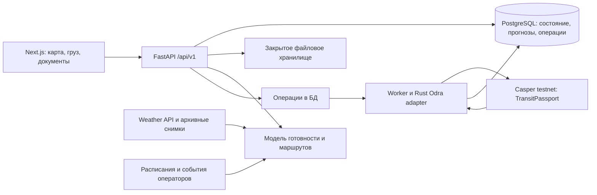

# Архитектура Caspian Flow

Решение: Next.js-клиент обращается к одному REST API. Python backend считает прогноз и маршруты, хранит рабочие данные и вызывает небольшой Rust-адаптер контракта Odra. Frontend получает готовые DTO, не вычисляет логистику и не подключается к Casper напрямую в P0.

Это целевая архитектура. Первый реализованный срез находится в `backend/`: FastAPI + HTTPX + SQLite-кэш для Open-Meteo/PortWatch. Он работает на 8000 отдельно от mock перевозок на 4010. PostgreSQL для отправок, модель задержек, worker и Odra adapter пока не реализованы. Интеграция в одно API выполняется после замены mock действий; подробности запуска — [backend README](../backend/README.md).



Для хакатона backend и worker могут жить в одном репозитории и запускаться двумя процессами. Redis, Kafka и микросервисы не нужны. API и worker — обычные долгоживущие контейнеры; frontend размещается независимо. Конкретный хостинг выбрать после проверки доступа команды, здесь он не провиженится.

## Границы ответственности

| Компонент | Отвечает за |
| --- | --- |
| Next.js | Представление, ввод, polling операции, локальные фильтры, форматирование единиц |
| API | Авторизацию роли, валидацию, версии, idempotency, сборку ответа карточки |
| Модель | ETA P10/P50/P90, вероятность пропустить рейс, причины и сравнение вариантов |
| Route engine | Граф с расписанием, текущая позиция, ограничения и доступные отправления |
| Worker | Подписание testnet-транзакций, retry, ожидание исполнения, сверку chain state |
| Odra | Права вызова, неизменяемую связь подтверждения с версией, отзыв и события |

API отдаёт `Shipment` целиком для согласованного снимка карточки: `revision`, прогноз, маршруты, документы, паспорт и события. Для P0 это снижает число запросов и риск смешать данные разных версий. List возвращает краткие записи.

## Модель готовности

В каждой симуляции:

```text
ready_at = max(arrival_at + unloading + terminal_queue,
               documents_ready_at) + loading_buffer
eligible_sailing = первое допустимое отправление,
                  у которого cargo_cutoff >= ready_at,
                  есть ёмкость и выполнены погодные ограничения
delivery_at = departure(eligible_sailing) + sea_duration + destination_handling
p_miss = доля симуляций, где ready_at > cutoff выбранного рейса
```

Зависимости этапов уточняются по реальному процессу терминала. Погода влияет на длительности и допустимые рейсы; универсальный порог высоты волны не назначать как норматив — параметры зависят от судна и оператора. Нет подходящего рейса в горизонте — `feasible=false`, ETA и риск могут быть `null`, причина объяснена. Отсутствие данных не равно нулевому риску.

При изменении прогноза сохраняются `forecast_id`, `generated_at`, `valid_until`, версия модели и качество входов. Выбор маршрута передаёт `forecast_id` и `expected_revision`; просроченный расчёт приводит к 409 и обновлению карточки. Прогнозы не записываются в chain при каждом обновлении.

## Хранение

Планируемые сущности: shipments; route_plans и route_legs; source_observations; forecasts; document_versions; passport_versions; attestations; operations/outbox; audit_events. Ключи внешних источников и timestamp нужны для дедупликации. API revision — целое число optimistic concurrency; passport version меняется только при изменении согласуемого содержимого.

Документ хранится приватно, SHA-256 вычисляет backend по фактическим байтам. `documents_hash` — хеш канонического манифеста документов; `route_hash` — хеш канонического плана. Для настоящего контракта специфицировать canonical JSON и сортировку, domain separation, непубличную соль манифеста; сохранить соль для разрешённой проверки. Mock использует простой детерминированный JSON и не является реализацией криптографического протокола.

В chain: случайный публичный ID отправки, версия, hashes, необходимые роли, адреса/подтверждения, сроки. Вне chain: инвойсы, наименования компаний, номера контейнеров, координаты, коммерческие условия. Публичная сеть всё равно раскрывает метаданные активности; deployment для пилота требует отдельного выбора участников и модели доступа.

## TransitPassport на Odra

Простой вариант реализован в [contracts/](../contracts/README.md): три фиксированных адреса, пять методов, одно решение роли в версии. Он заменяет предварительную идею динамического управления участниками ниже; реестр и администратор ролей в MVP не нужны. Локальные тесты и WASM готовы; контракт развёрнут в testnet, конфигурация в contracts/deployments/testnet.json. Backend adapter ещё не подключён.

Один контракт хранит несколько паспортов. Стек Odra поддерживает Casper backend и локальное тестирование; интеграцию с сетью выполняет Livenet backend. Зафиксировать совместимые версии после минимального deploy в первые часы. [Casper backend](https://odra.dev/docs/backends/casper/), [OdraVM](https://odra.dev/docs/backends/odra-vm/), [Livenet](https://odra.dev/docs/backends/livenet/).

Предлагаемые entrypoints — это проектный интерфейс, ещё не написанный код:

```text
create_passport(shipment_id, documents_hash, route_hash, required_roles)
revise_passport(shipment_id, expected_version, documents_hash, route_hash)
attest(shipment_id, expected_version, decision, valid_until)
revoke_attestation(shipment_id, expected_version)
get_passport(shipment_id)
```

Роль определяется через caller и привязку к участнику конкретного груза, а не из непроверенного поля запроса. Создание/пересмотр — оператор отправки; подтверждение — назначенный участник. Администратор контракта управляет разрешёнными адресами, но не подтверждает за участника. Это следует покрыть тестами.

`ready` — вычисляемое состояние текущей версии: все требуемые роли дали действующее approval, нет rejection/revocation. Истечение времени вычисляется при чтении/вызове; контракт сам не запускается по таймеру. Замена документа или маршрута увеличивает version и делает предыдущие attestations неактуальными. Записи истории не удаляются.

`ready` означает готовность цифрового комплекта по правилам прототипа. Таможенная роль — simulator до официальной интеграции; фактический выпуск товара не выполняется этим контрактом.

События: PassportCreated, PassportRevised, Attested, AttestationRevoked. Worker обновляет проекцию из успешного результата и чтения состояния. При перезапуске повторно читает незавершённые операции; callback/SSE не является единственным источником истины.

## Подпись и согласованность

В testnet P0 backend держит **раздельные демонстрационные ключи ролей**. Выбранная роль связывается с проверенной сервером demo-сессией; ключи не попадают в Next.js и не выводятся в логи. Это управляемый стенд, а не независимая подпись организаций. Для пилота нужен wallet либо внешний signer каждой организации.

REST mutation возвращает 202 и Operation. `queued → submitted → confirmed` или `failed`. Submitted не означает исполнение. В mock путь `queued → simulated`; `transaction_hash=null`, `network=mock`. При testnet только successful execution и проверка соответствующего состояния позволяют confirmed; failed/expired не меняют действующую версию.

Для route/document mutation до chain confirmation хранится proposed change, действующая версия остаётся прежней. Worker фиксирует подтверждённую проекцию атомарно. При успешном chain и сбое БД восстанавливает проекцию чтением chain. Idempotency key связывается с actor + endpoint + payload; повтор с другим payload — 409. На отправку допускается одна pending mutation; версия повторно проверяется перед применением.

## Расчёт выбросов

Базовая оценка: сумма по участкам `mass_tonnes × distance_km × factor_kg_co2e_per_tonne_km`, плюс отдельно подтверждённые операции терминала/ожидание. Если источник даёт TEU-km, использовать TEU, не подставлять тонны. Коэффициент хранится с единицей, технологией, регионом, годом и источником. У обоих маршрутов должны совпадать границы учёта. [GLEC Framework](https://www.smartfreightcentre.org/documents/328/GLEC_FRAMEWORK_v3_UPDATED_02_04_24.pdf).

Mock использует только условные коэффициенты для UI. Это не сертифицированный расчёт и не значения, извлечённые из GLEC.

## Отказы и проверка

- API недоступен: сохранить последнюю карточку с предупреждением и временем обновления.
- Погода отсутствует: `null`/missing и последний снимок с stale; не обещать точную вероятность.
- Устаревший выбор маршрута: 409, refetch, повторное решение пользователя.
- RPC timeout: операция остаётся pending/unknown до сверки; не отправлять повторную мутацию вслепую.
- CORS разрешает только frontend origin; production auth проверяет доступ к конкретной отправке.
- Проверки модели: пропуск cutoff, отсутствие рейсов, ограничения маршрута, отсутствие данных.
- Проверки контракта: чужая роль, старая версия, expiry, revoke, повтор и смена документа.
- E2E: сценарий → вариант → операция → новая версия → три подтверждения → замена документа.
